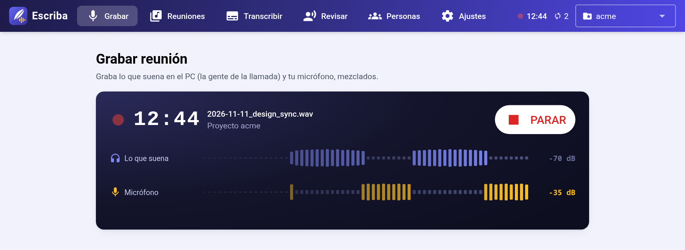
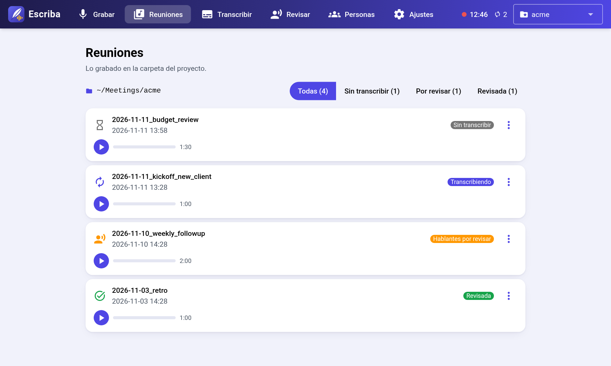
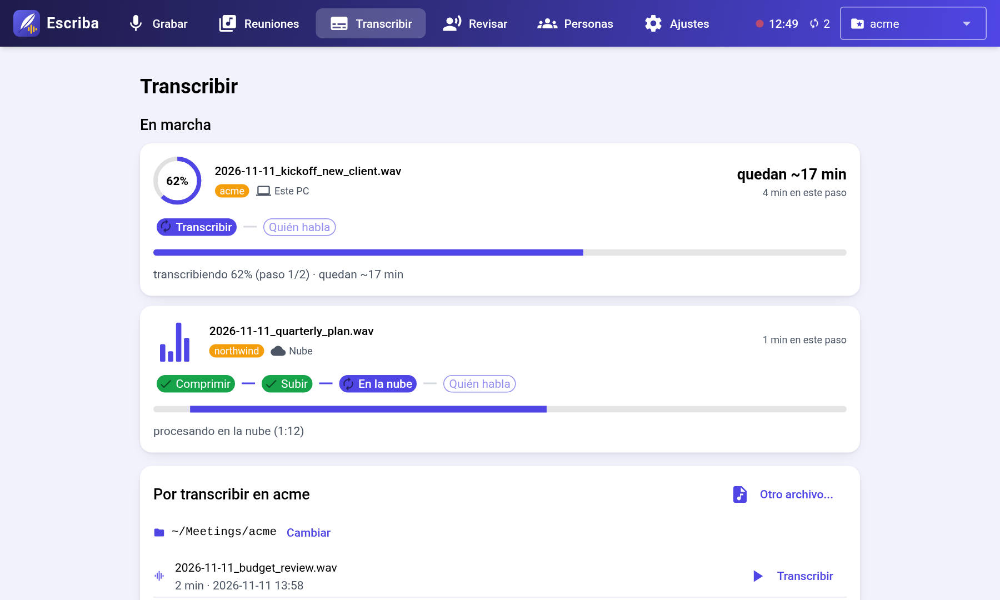
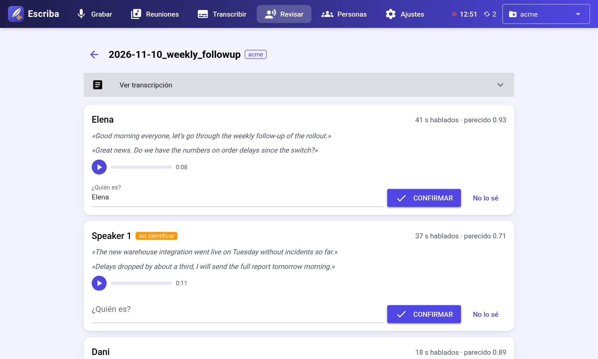
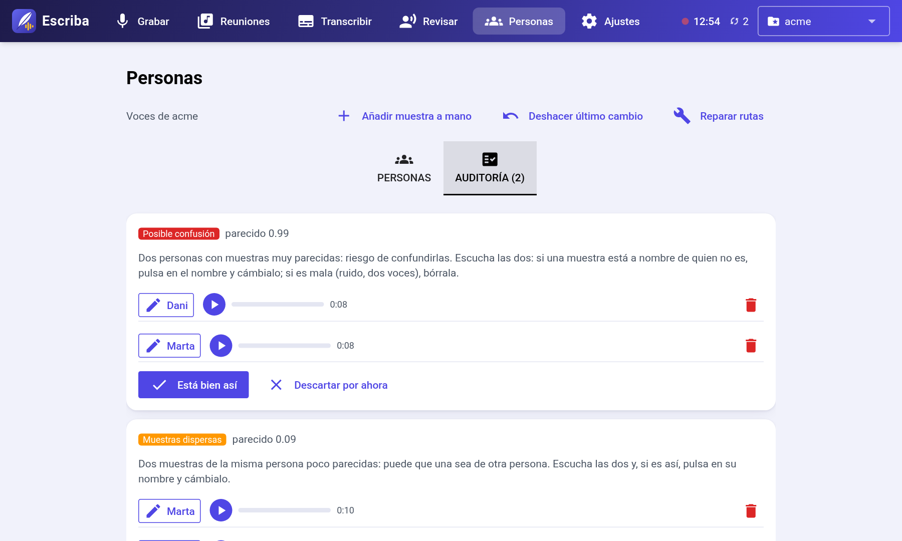

# escriba

*[Read in English](README.md)*

Graba, transcribe e identifica a quién habla en tus reuniones, en Windows y Linux.

- **Graba** el audio de la llamada y tu micrófono juntos, sin programas adicionales.
- **Transcribe** en la nube con AssemblyAI (~0,23 $ por hora de audio) o en local con faster-whisper y pyannote.
- **Identifica a los hablantes** por la voz, con una biblioteca por proyecto que mejora cada vez que revisas una transcripción.
- **Archiva** las reuniones revisadas en Opus, unas 15 veces más pequeñas.

Interfaz en el navegador y menú de terminal, en castellano e inglés.



## Antes de grabar

Avisa a todos de que grabas; en muchos países necesitas su consentimiento. Las huellas de voz son datos biométricos (categoría especial del RGPD): guarda la biblioteca en privado y borra las muestras de una persona si te lo pide. El modo nube envía el audio a AssemblyAI (EE. UU.); usa el modo local si no debe salir de tu organización. El uso legal de escriba es responsabilidad tuya.

## Instalación

**Windows:** descarga el repositorio y ejecuta `install.ps1` (clic derecho > *Ejecutar con PowerShell*). Lo instala todo en tu carpeta de usuario, sin permisos de administrador, y crea un acceso directo *Escriba*.

```powershell
powershell -ExecutionPolicy Bypass -File install.ps1           # nube
powershell -ExecutionPolicy Bypass -File install.ps1 -Local    # nube + local
powershell -ExecutionPolicy Bypass -File install.ps1 -Uninstall
```

Para actualizar, cierra escriba y ejecuta el `install.ps1` de la versión nueva.

**Linux:** necesita [`uv`](https://docs.astral.sh/uv/) y `libpulse`.

```bash
uv tool install --python 3.11 "escriba @ file://$PWD"
escriba install-local    # opcional: modo local
```

## Uso

```bash
escriba web      # interfaz en el navegador (http://127.0.0.1:8765)
escriba          # menú de terminal
escriba --help   # órdenes
```

La primera vez, pega tu clave de AssemblyAI en *Ajustes*.

<table>
<tr>
<td></td>
<td></td>
</tr>
<tr>
<td></td>
<td></td>
</tr>
</table>

## Modo local

Opcional, unos 1,5 GB. Instálalo desde *Ajustes*, con `escriba install-local` o con `install.ps1 -Local`. Además necesita un [token de Hugging Face](https://hf.co/settings/tokens) con las condiciones de [speaker-diarization-3.1](https://hf.co/pyannote/speaker-diarization-3.1) y [speaker-diarization-community-1](https://hf.co/pyannote/speaker-diarization-community-1) aceptadas.

En CPU tarda alrededor de 1 h 15 min por hora de audio.

**GPU NVIDIA (experimental):** `escriba install-local --gpu` o `install.ps1 -Gpu` (~5 GB, driver 528+ en Windows, 525+ en Linux). Aún sin probar en hardware real; si la GPU falla, escriba sigue con la CPU. Se agradecen los informes.

## Datos

Las grabaciones y transcripciones se quedan en la carpeta de cada proyecto. Las bibliotecas de voces, el glosario, las claves y los ajustes están en `%LOCALAPPDATA%\escriba` (Windows) o `~/.local/share/escriba` (Linux).

## Desarrollo

```bash
uv venv --python 3.11 .venv
uv pip install --torch-backend cpu -e ".[local]" pytest
.venv/bin/python -m pytest
```

Los textos de la interfaz están en inglés dentro de `_()` y se traducen en `escriba/locales/<idioma>.json`.

Las huellas de voz usan el codificador de voz de [Resemblyzer](https://github.com/resemble-ai/Resemblyzer) (Apache-2.0), reimplementado en numpy.

## Licencia

Con licencia [Apache 2.0](LICENSE-APACHE) o [MIT](LICENSE-MIT), a tu elección.
