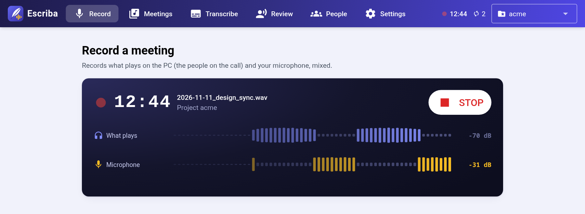
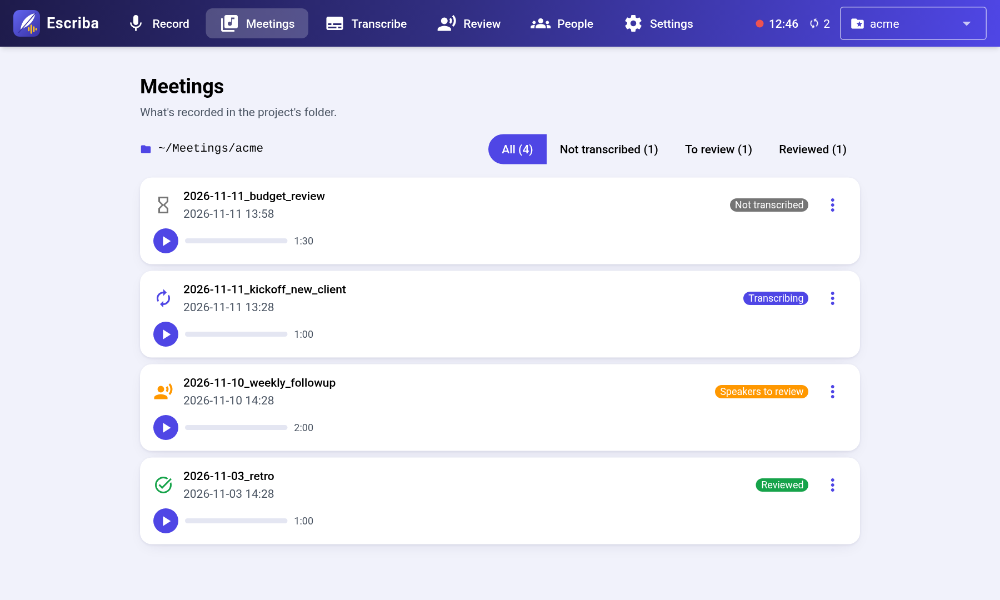
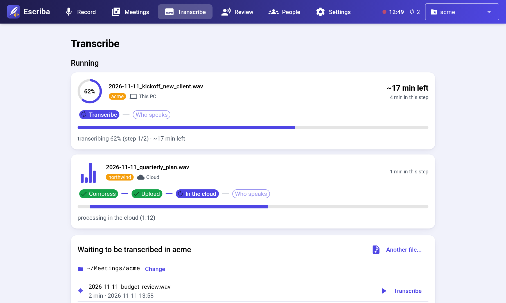
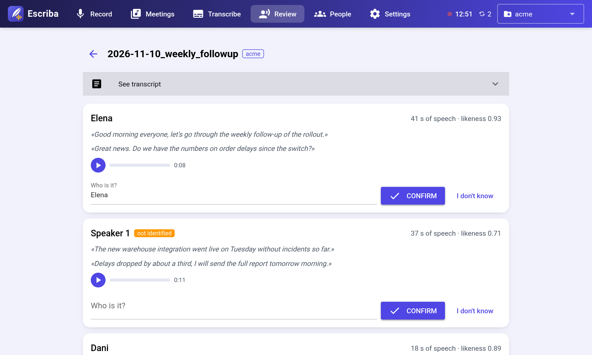
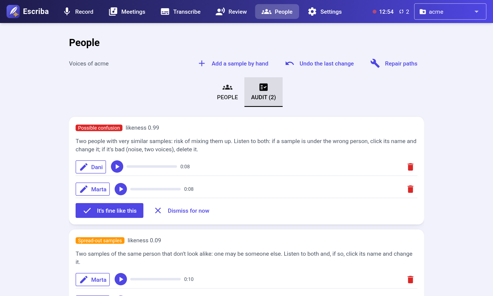

# escriba

*[Leer en castellano](README.es.md)*

[](https://github.com/Carlolius/escriba/actions/workflows/ci.yml)
[](https://github.com/Carlolius/escriba/releases)
[](#license)


**Record your meetings, get a transcript and know who said what.**

escriba records the call and your microphone, transcribes them in the cloud or on your PC, and recognizes each speaker by voice. It learns the voices of each project as you review transcripts, so every meeting needs fewer corrections than the last.



> [!WARNING]
> **Recording people has legal consequences.**
> - **Ask first.** Tell everyone you are recording before you start. In many countries it is illegal without their consent.
> - **Voiceprints are biometric data.** Under the GDPR they are a special category of personal data. Keep the voice library private and delete a person's samples if they ask.
> - **Cloud mode sends the audio to the USA** (AssemblyAI). If a meeting must not leave your organization, use local mode.
>
> You are responsible for using escriba lawfully.

## Features

- **Recording** of the call audio and your microphone into a single file, with no extra software.
- **Transcription** in the cloud or fully offline, with a glossary for names and jargon.
- **Speaker identification** by voice, with a separate voice library per project.
- **Review** of each speaker with sample sentences and audio, so you can confirm or correct who it is.
- **Archiving** of reviewed meetings as Opus, about 15x smaller.
- **Browser interface and terminal menu**, in English and Spanish, with color themes (Gruvbox, Tokyo Night, Catppuccin, Dracula, Nord...).

## Cloud or local

| | Cloud (AssemblyAI) | Local |
|---|---|---|
| Time per hour of audio | a few minutes | ~1 h 15 min on CPU |
| Cost | ~$0.23 per hour | free |
| Audio leaves your PC | yes | no |
| Extra install | none | ~1.5 GB |

Speakers are always identified on your PC, in both modes.

## Install

### Windows

Download the latest version from [Releases](https://github.com/Carlolius/escriba/releases) (*Source code (zip)*), unzip it and run `install.ps1` (right-click > *Run with PowerShell*). It installs into your user folder, needs no admin rights and creates an *Escriba* shortcut.

```powershell
powershell -ExecutionPolicy Bypass -File install.ps1           # cloud
powershell -ExecutionPolicy Bypass -File install.ps1 -Local    # cloud + local
powershell -ExecutionPolicy Bypass -File install.ps1 -Uninstall
```

To update, close escriba and run the `install.ps1` of the new version.

### Linux

Requires [`uv`](https://docs.astral.sh/uv/) and `libpulse`. From the folder of the [latest version](https://github.com/Carlolius/escriba/releases):

```bash
uv tool install --python 3.11 "escriba @ file://$PWD"
escriba install-local    # optional: local mode
```

## Getting started

1. Open escriba with `escriba web` (or the *Escriba* shortcut) and paste your [AssemblyAI](https://www.assemblyai.com) key in *Settings*.
2. Create a project and choose the folder where its meetings will be saved.
3. **Record** the meeting, **Transcribe** it and **Review** who each speaker is.

Prefer the terminal? Run `escriba` for the menu, or `escriba --help` for individual commands.

<table>
<tr>
<td></td>
<td></td>
</tr>
<tr>
<td></td>
<td></td>
</tr>
</table>

## Local mode

Install it from *Settings*, with `escriba install-local` or with `install.ps1 -Local`. It also needs a [Hugging Face token](https://hf.co/settings/tokens) with the conditions of [speaker-diarization-3.1](https://hf.co/pyannote/speaker-diarization-3.1) and [speaker-diarization-community-1](https://hf.co/pyannote/speaker-diarization-community-1) accepted.

> [!NOTE]
> **NVIDIA GPU (experimental).** `escriba install-local --gpu` or `install.ps1 -Gpu` (~5 GB; driver 528+ on Windows, 525+ on Linux) brings local mode down to minutes. It has not been tested on real hardware yet, and if the GPU fails escriba falls back to the CPU. Please [open an issue](https://github.com/Carlolius/escriba/issues) to tell us how it went.

## Your data

Recordings and transcripts stay in each project's folder. Voice libraries, glossary, keys and settings are kept in `%LOCALAPPDATA%\escriba` on Windows and `~/.local/share/escriba` on Linux. Nothing is sent anywhere except the audio you transcribe in cloud mode.

## Development

```bash
uv venv --python 3.11 .venv
uv pip install --torch-backend cpu -e ".[local]" pytest
.venv/bin/python -m pytest
```

Interface texts are written in English inside `_()` and translated in `escriba/locales/<language>.json`. Voiceprints use [Resemblyzer](https://github.com/resemble-ai/Resemblyzer)'s voice encoder (Apache-2.0), reimplemented in numpy.

## Contributing

Issues and pull requests are welcome. See [CONTRIBUTING.md](CONTRIBUTING.md).

## License

Licensed under either of [Apache License 2.0](LICENSE-APACHE) or [MIT license](LICENSE-MIT), at your option.
